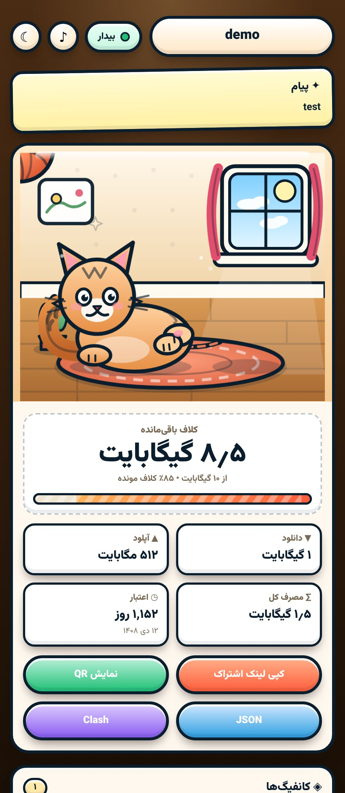
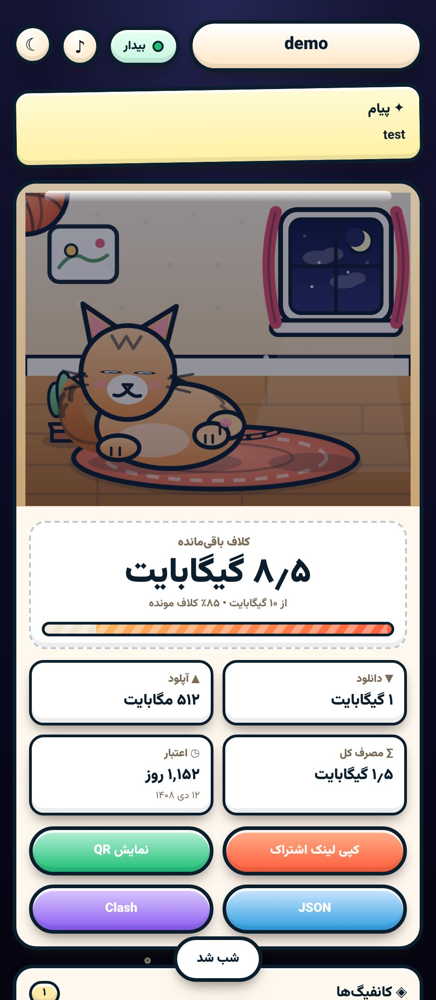
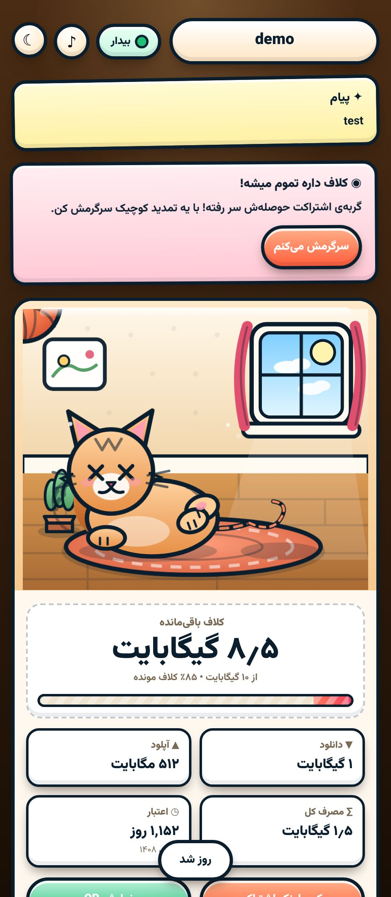

# yarn cat subscription page

A small Persian subscription page with a cat playing with yarn.
The yarn ball shrinks as traffic runs out, so users see their quota at a glance.

## what it does

- shows remaining traffic, download/upload, total used and days left
- the yarn ball follows the remaining quota (shrinks and turns grey when low)
- the cat mood changes: happy, weak, sleep, panic, cry
- day/night toggle, the window shows sun or moon
- copy link and QR buttons, JSON and Clash export links
- live update every 10 seconds, offline-friendly
- announcement box and disabled-subscription notice

## files

- `sub.html` - page template (x-ui template tags)
- `style.css` - all the styling
- `app.js` - usage rendering, cat state, rows, QR, polling

## quick start

Drop the three files next to each other and serve them. The page reads
its data from `data-*` attributes on `<body>`, filled by the panel:

```html
<body data-dl="{{ .downloadByte }}" data-ul="{{ .uploadByte }}"
  data-cap="{{ .totalByte }}" data-exp="{{ .expire }}"
  data-sub="{{ .subUrl }}" data-ti="{{ .subTitle }}">
```

No build step. QR library loads lazily from cdnjs only when opened.

## easy install (x-ui panel)

If your panel serves a single subscription template file, merge the
three files into one before uploading:

```bash
unzip yarn-cat-subscription.zip -d yarn-cat
cd yarn-cat
cat style.css | python3 -c "import sys; print('<style>' + sys.stdin.read() + '</style>')"
```

Or the one-liner that builds `single.html` from the three files:

```bash
python3 - <<'PY'
h = open('sub.html').read()
css = open('style.css').read()
js = open('app.js').read()
h = h.replace('<link rel="stylesheet" href="./style.css">', '<style>\n' + css + '\n</style>')
h = h.replace('<script src="./app.js"></script>', '<script>\n' + js + '\n</script>')
open('single.html', 'w').write(h)
print('single.html ready:', len(h))
PY
```

Then upload `single.html` content as your subscription template.
Keep `sub.html` + `style.css` + `app.js` for editing, rebuild after changes.

## screenshots





## license

MIT
